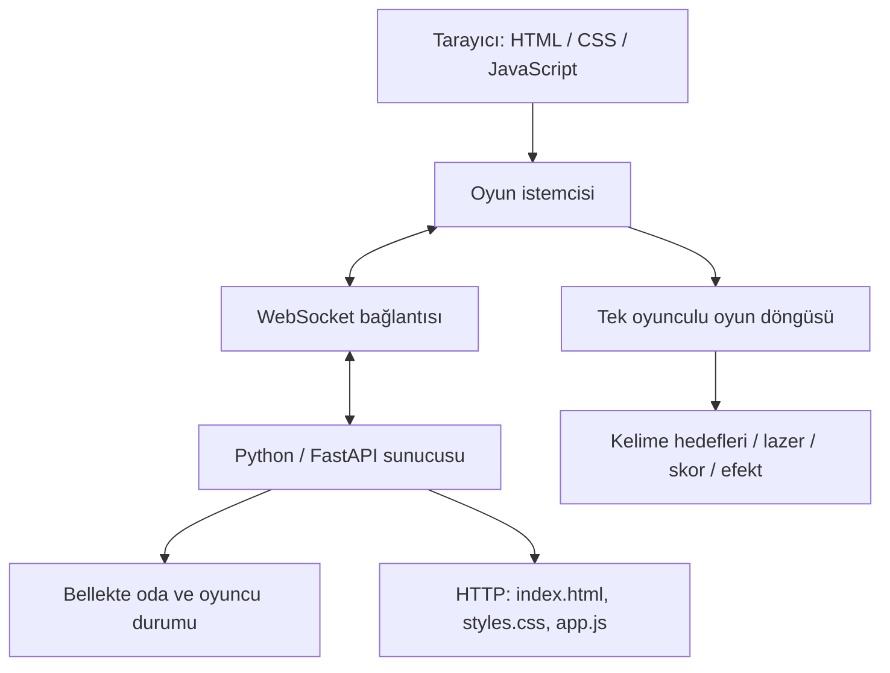

<div align="center">

# TYPING ARENA

### REFLEKSLERİNİ YAZ. HEDEFLERİ KİLİTLE. UZAYI KORU.

**Sıradan bir yazma testi değil.**  
Typing Arena, kelimeleri hedefe dönüştüren; hızını, doğruluğunu ve reflekslerini uzay temalı bir arenada sınayan tarayıcı tabanlı bir oyun.

<br/>


<br/>

**Masaüstü · Mobil · Tek Oyunculu · LAN Çok Oyunculu**

</div>

---

## İçindekiler

- [Oyun deneyimi](#-oyun-deneyimi)
- [Öne çıkan özellikler](#-öne-çıkan-özellikler)
- [Teknoloji yığını](#-teknoloji-yığını)
- [Hızlı başlangıç](#-hızlı-başlangıç)
- [Arkadaşlarınla aynı ağda oyna](#-arkadaşlarınla-aynı-ağda-oyna)
- [Mobilde nasıl oynanır?](#-mobilde-nasıl-oynanır)
- [Kontroller](#-kontroller)
- [Proje yapısı](#-proje-yapısı)
- [Mimari ve çalışma mantığı](#-mimari-ve-çalışma-mantığı)
- [Tema ve kişiselleştirme](#-tema-ve-kişiselleştirme)
- [Test ve doğrulama](#-test-ve-doğrulama)
- [Bilinen sınırlar](#-bilinen-sınırlar)
- [Geliştirme fikirleri](#-geliştirme-fikirleri)

---

## Oyun deneyimi

Ekrana yukarıdan düşen kelimeler, uzay geminin imha etmesi gereken hedeflerdir. Bir hedefe kilitlen, harfleri doğru sırayla yaz ve kelimeyi tamamladığında hedefin enerji çerçevesini parçalayarak yok et.

- **Doğru harfler:** Turuncu vurguyla ilerler.
- **Yanlış harfler:** Kırmızı geri bildirim verir.
- **Hedef kilidi:** Yazdığın karakterler yalnızca kilitli hedefe gönderilir.
- **İmha:** Son harfte hedef çerçevesi enerji parçalarına ayrılır.
- **Oyun temposu:** Seviye veya özel kelime/metin listesiyle belirlenir.

Typing Arena'nın amacı yalnızca hızlı yazmak değil; hedef seçimini, doğruluğu ve ritmi birlikte yönetmektir.

## Öne çıkan özellikler

| Özellik | Açıklama |
|---|---|
| **Uzay savaş alanı** | Yıldızlar, uzay atmosferi, lazer ve hedef animasyonlarıyla oyun sahnesi |
| **Hedefe kilitlenme** | Aktif kelime hedefi ve gemiden hedefe uzanan lazer çizgisi |
| **Harf bazlı geri bildirim** | Doğru ve yanlış karakterler farklı renklerle gösterilir |
| **Parçalı imha animasyonu** | Kelime tamamlandığında dikdörtgen çerçeve sekiz enerji parçasına ayrılır |
| **Mobil yazı girişi** | Dokunmatik ekrana uygun giriş çubuğu ve telefonun sanal klavyesiyle yazma |
| **25 özgün avatar** | Kodla üretilen, harici karakter görseli gerektirmeyen SVG avatar seçimi |
| **Seviye sistemi** | Hazır oyun seviyeleri ve ayarlanabilir zorluk |
| **Özel kelime listesi** | Kendi kelimelerini veya metnini oyuna ekleme |
| **Kişisel temalar** | Arka plan, hedef kutusu, kenarlık, yazı rengi ve boyutu gibi görünüm ayarları |
| **Tema kaydetme** | İsim verdiğin temaları tarayıcıda saklama, yeniden yükleme ve silme |
| **Ses paketleri** | Synth, lazer, arcade ve yumuşak ses karakterleri |
| **LAN çok oyunculu** | Oda koduyla aynı yerel ağdaki oyuncuları bir araya getirme |
| **Oda yöneticisi** | Odayı oluşturan oyuncu oyunu başlatabilir |
| **Oyuncu listesi** | Odadaki oyuncuların adları, avatarları ve skorları |
| **Geçici tema paylaşımı** | Oyun başlatılırken seçilen tema oda oyuncularına iletilir |

> **Not:** Çok oyunculu oda ve oyun oturumu sunucu belleğinde tutulur. Sunucu kapatıldığında oturum sona erer.

## Teknoloji yığını

<div align="center">

| Katman | Teknoloji | Sorumluluk |
|:--|:--|:--|
| Arayüz | HTML5 | Menü, oyun alanı, profil ve ayarlar |
| Görsel tasarım | CSS3 | Uzay teması, responsive düzen ve animasyonlar |
| Oyun istemcisi | Vanilla JavaScript | Oyun döngüsü, kelime girişi, lazer, ses ve WebSocket |
| Sunucu | Python + FastAPI | HTTP servisleri ve oda yönetimi |
| Gerçek zamanlı iletişim | WebSocket | Oda, oyuncu ve oyun mesajları |
| Çalıştırma | Uvicorn | ASGI sunucusu |

</div>

Framework bağımlılığı düşük tutulmuştur: istemci tarafında ayrı bir JavaScript framework'ü veya derleme adımı gerekmez.

## Hızlı başlangıç

### Gereksinimler

- Python **3.10 veya üzeri**
- Güncel bir web tarayıcısı
- İlk kurulum için internet bağlantısı (Python paketlerini indirmek üzere)

### Windows

1. Projeyi bilgisayarına indir ve ZIP arşivini çıkart.
2. `cyber_typer` klasörünü aç.
3. `BAŞLAT.bat` dosyasına çift tıkla.
4. Gerekli Python paketleri eksikse başlatıcı bunları `requirements.txt` üzerinden kurar.
5. Tarayıcıda oyun otomatik açılır. Açılmazsa şu adresi kullan:

```text
http://127.0.0.1:8000
```

### Terminal üzerinden

Proje klasöründe:

```bash
python launcher.py
```

Bağımlılıkları elle kurmak istersen:

```bash
python -m pip install -r requirements.txt
python launcher.py
```

Sunucuyu durdurmak için terminal penceresinde `Ctrl + C` tuşlarına bas.

## Arkadaşlarınla aynı ağda oyna

Typing Arena, aynı Wi-Fi veya yerel ağa bağlı oyuncuların oda koduyla buluşmasını destekler.

1. Oyunu çalıştıracak kişi `BAŞLAT.bat` dosyasını açar.
2. Başlatıcı konsolunda **Aynı ağdaki oyuncular** satırında gösterilen adresi bulur.
3. Arkadaşların bu adresi kendi tarayıcılarına yazar.
4. Bir oyuncu oda oluşturur.
5. Diğer oyuncular oda kodunu girerek katılır.
6. Oda yöneticisi oyunu başlatır.

Örnek adres biçimi:

```text
http://192.168.1.35:8000
```

`192.168.1.35` yalnızca örnektir. Kendi bilgisayarında gösterilen IP adresini kullanmalısın.

### Bağlantı kurulamıyorsa

- Herkesin aynı Wi-Fi/LAN üzerinde olduğundan emin ol.
- Sunucuyu çalıştıran bilgisayarın açık ve `launcher.py` sürecinin çalışır durumda olması gerekir.
- Windows Güvenlik Duvarı, Python/Uvicorn için gelen bağlantıyı engelliyor olabilir. Gerekirse özel ağlarda izin ver.
- Misafir Wi-Fi ağlarında cihazlar arası bağlantı engellenmiş olabilir.

**İnternet üzerinden oynama:** Bu kurulum varsayılan olarak yerel ağ içindir. Farklı ağlardaki oyuncular için sunucuyu erişilebilir bir ortama dağıtmak veya güvenli bir VPN/tünel kullanmak gerekir. Portu doğrudan internete açmadan önce erişim kontrolü ve güvenlik önlemleri eklenmelidir.

## Mobilde nasıl oynanır?

Mobil görünümde oyun alanı ekran genişliğini kullanır ve yazı girişi için alt bölümde özel bir giriş alanı bulunur.

1. Oyunu telefon tarayıcısında aç.
2. Oyunu başlat.
3. Ekranın altındaki **HEDEFİ YAZ** alanına dokun.
4. Telefonun sanal klavyesinden kilitli kelimeyi yaz.
5. Gerekirse **SİL** düğmesiyle son karakteri geri al.
6. Oyun alanına dokunarak giriş alanını yeniden odakla.

Mobil tarayıcıların klavye ve ekran alanı davranışları farklılık gösterebilir. Gerçek cihazlarda ayrıca test edilmesi önerilir.

## Kontroller

| İşlem | Kontrol |
|---|---|
| Hedefe yazma | Klavyeden kelimeyi yaz |
| Mobil yazma | **HEDEFİ YAZ** alanına dokun |
| Son harfi silme | `Backspace` veya **SİL** |
| Hedef değiştirme | Oyun alanındaki başka bir kelimeyi seç |
| Oda oluşturma | Çok oyunculu menüsündeki oda oluştur düğmesi |
| Odaya katılma | Oda kodunu gir ve katıl |
| Oyunu başlatma | Oda yöneticisinin başlat düğmesi |

## Proje yapısı

```text
cyber_typer/
├── index.html          # Oyun arayüzü ve menüler
├── styles.css          # Tasarım, responsive kurallar ve animasyonlar
├── app.js              # Oyun motoru ve tarayıcı tarafı davranışlar
├── server.py           # FastAPI ve WebSocket sunucusu
├── launcher.py         # Kurulum kontrolü ve sunucu başlatıcı
├── requirements.txt    # Python bağımlılıkları
├── BAŞLAT.bat          # Windows başlatma kısayolu
└── README.md           # Proje dokümantasyonu
```

### Dosyalar ne yapıyor?

- **`index.html`** — Menüleri, oyun alanını, oyuncu profilini, avatar seçimini, oda arayüzünü ve ayar kontrollerini tanımlar.
- **`styles.css`** — Uzay görünümünü, renkleri, ekran boyutlarına göre yerleşimi, dokunmatik alanları ve hedef imha animasyonunu biçimlendirir.
- **`app.js`** — Kelime/hedef üretimini, oyun döngüsünü, klavye girişini, lazer çizimini, ses efektlerini, temaları, avatarları ve WebSocket istemcisini yönetir.
- **`server.py`** — Ana sayfayı ve statik dosyaları sunar; WebSocket üzerinden oda oluşturma, odaya katılma, oyuncu listesi ve oyun başlangıcı mesajlarını yönetir.
- **`launcher.py`** — Gerekli sunucu paketini kontrol eder, yerel ağ IP adresini bulur, bağlantı adreslerini gösterir ve Uvicorn'u başlatır.

## Mimari ve çalışma mantığı



### Çok oyunculu mesaj akışı

- İstemci WebSocket bağlantısı açar.
- `create` mesajı yeni oda oluşturur.
- `join` mesajı geçerli ve henüz başlamamış odaya oyuncu ekler.
- `start` mesajı oda yöneticisinin oyun ayarlarını, kelime listesini ve temasını sunucuya iletir.
- Oyuncu skor/ilerleme güncellemeleri oda üyelerine yayınlanır.
- Oyuncu ayrıldığında oda listesi güncellenir; yönetici ayrılırsa yeni yönetici atanır.

## Tema ve kişiselleştirme

Görünüm ayarlarıyla oyun sahnesini kendi tarzına göre düzenleyebilirsin:

- Hazır renk paletleri ve arka plan görünümleri
- Matrix kod yağmuru görünümü
- Görsel dosyasından arka plan seçimi
- Hedef kutusu arka plan rengi
- Hedef kutusu kenarlık rengi
- Kelime yazı rengi
- Yazı boyutu ve keskinlik ayarı
- Vurgu rengi
- İsim vererek tema kaydetme, yükleme ve silme

Kaydedilen temalar tarayıcının `localStorage` alanında tutulur. Bu nedenle tema kayıtları aynı tarayıcı/profil için yereldir; başka cihaza otomatik taşınmaz.

Çok oyunculu oyunda oda yöneticisinin oyun başlangıcında gönderdiği tema, oturum için diğer oyunculara aktarılır. Bu aktarım kalıcı bir tema senkronizasyonu değildir.

## Test ve doğrulama

Bu paket hazırlanırken aşağıdaki kontroller uygulanmıştır:

- Python dosyalarının derleme kontrolü
- JavaScript sözdizimi kontrolü
- Sunucunun ana sayfa ve statik dosya HTTP uçlarının kontrolü
- ZIP arşivinin açılabilirlik kontrolü

Aşağıdaki senaryoların gerçek cihazlarda ayrıca doğrulanması gerekir:

- Farklı Android/iOS tarayıcılarında sanal klavyenin açılması ve odak davranışı
- Ekran klavyesi açılırken oyun alanının kullanılabilir kalması
- Farklı ekran oranlarında avatar ve menü yerleşimi
- Birden fazla gerçek cihazla uçtan uca çok oyunculu oda testi
- Farklı ağ koşullarında bağlantı kararlılığı

Test edilmemiş bir cihaz veya senaryo için başarı garantisi verilmez.

## Bilinen sınırlar

- Oda verileri sunucu belleğinde tutulur; sunucu yeniden başlatıldığında silinir.
- Oda sistemi varsayılan olarak aynı yerel ağ kullanımı için tasarlanmıştır.
- Uygulamada üretim ortamına yönelik kullanıcı hesabı, kimlik doğrulama veya kalıcı skor veritabanı bulunmaz.
- Tema kayıtları tarayıcı `localStorage` alanında saklanır.
- Mobil klavye davranışı tarayıcı/işletim sistemi kombinasyonuna bağlıdır ve fiziksel cihaz testi gerektirir.

## Geliştirme fikirleri

Katkı ve geliştirme için değerlendirilebilecek sonraki adımlar:

- Kalıcı oyuncu profilleri ve skor tablosu
- Oda erişim parolası ve sunucu tarafı doğrulama
- İnternet üzerinden güvenli çok oyunculu eşleştirme
- Oyun sonu istatistikleri ve yazma hızı (WPM) analizi
- Erişilebilirlik seçenekleri ve azaltılmış animasyon modu
- Otomatik tarayıcı testleri ve gerçek cihaz test matrisi

---

<div align="center">

**HIZLI YAZ. DOĞRU KİLİTLE. HEDEFİ İMHA ET.**

Typing Arena — klavyenin uzay savaşına dönüştüğü yer.

</div>
